# FitPlan

Java 原生 Android 训练记录应用。核心训练记录、规则推荐与周报完全离线运行，并内置可选联网的 AI 健身教练，支持每日状态填写、训练计划、逐组记录、休息计时、历史修正、中英双语周报与多厂商自定义 API Key 的 AI 建议。

## v0.7.1 极简欢迎页、指标配色统一与步进器布局优化

2026 年 11 月 28 日更新。

- **极简 2 秒动态欢迎页**：新增冷启动欢迎页（`WelcomeActivity`），采用纯黑 `#000000` 画布、与主题三环呼应的红/绿/青动态弧线、白绿撞色 `FitPlan` 与 `Train Smart · Stay Strong` 标语，停留约 2 秒（点击可跳过）后淡入进入首页；同步将应用与 Android 12+ 启动窗口底色统一为纯黑无闪烁。
- **全局指标语义配色统一**：将首页「今日训练」三环、「每周走势」四格卡片及「我的」个人概况指标的语义颜色完全对齐——组数（珊瑚红 `#FA114F`）、动作/天数/打卡（荧光绿 `#92E82A`）、训练时长（青蓝 `#00D9F5`）、训练次数（琥珀橙 `#FF9F0A`）。
- **计划详情步进器防重叠**：优化重量 / 组数 / 次数步进器尺寸与行间留白，数字气泡框与加减按钮不再贴边或重叠。

应用版本为 0.7.1，versionCode 为 22。代码仓库不包含任何内置 API Key，使用说明见 [AI 教练配置说明](docs/AI_COACH.md)。

| 极简三环欢迎页 | 配色统一后的首页 |
|---|---|
| 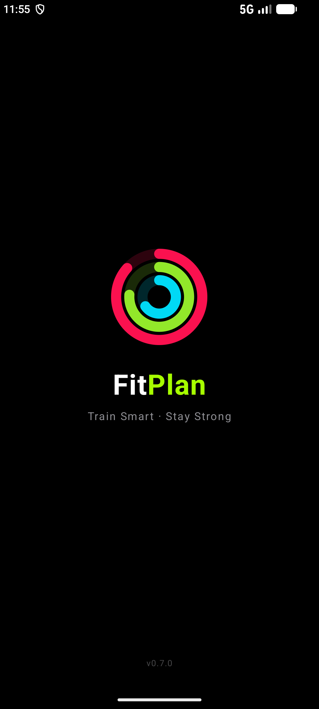 | 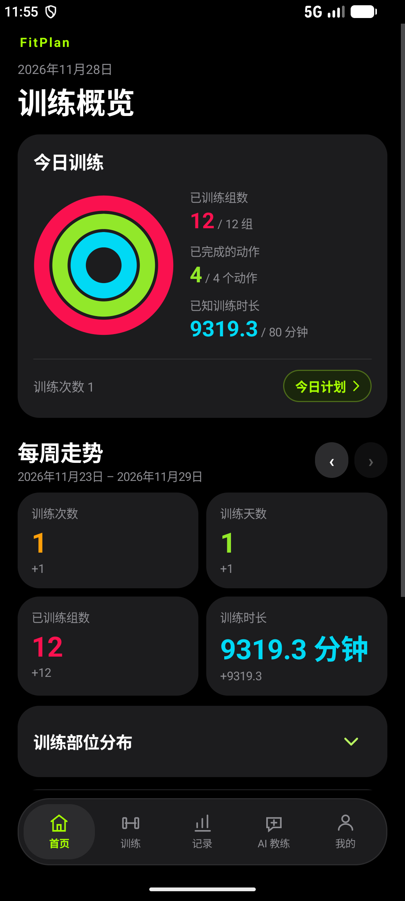 |

## v0.7.0 AI 多模型配置、教练形象、个人中心整合与 Apple Fitness 界面改版

2026 年 11 月 28 日更新。

- **可视化 AI 模型与 API Key 配置**：支持在应用内直接切换模型服务商（默认智谱 GLM、DeepSeek、通义千问 Qwen、OpenAI 及自定义 OpenAI 兼容接口）、选择预设模型或自定义模型 ID、粘贴个人 API Key，并提供一键「测试连接」与「恢复默认」。个人 API Key 仅保存于本机私有存储，已从云备份排除。
- **AI 教练形象与对话体验优化**：新增默认运动风教练头像框与在线状态指示点，支持从相册自定义头像及一键恢复默认；快捷预设问题移动至对话列表底部输入框上方，交互更顺手。
- **「我的」个人中心整合**：整合累计训练、完成组数、状态打卡三项概况指标与最近一次身体状态快照，并将原「AI 教练」页的「我的训练档案」迁移至此（共享本地 SQLite 数据，AI 教练实时读取）；语言切换改为带中国国旗 / 英国国旗 / 地球仪图标的三卡即时切换。
- **Apple Fitness 风格全前端改版与双语防溢出**：统一采用真黑 `#000000` 画布、iOS 暗灰卡片 `#1C1C1E`、经典红/绿/青三环、悬浮胶囊底栏与全局语义化按钮体系（新增/删除/返回统一）；今日计划与个人档案改用 3×2 部位药丸标签与 iOS 分段控件，全量移除文本按钮固定高度并精简中英文文案，彻底消除英文界面按钮裁切。

应用版本为 0.7.0，versionCode 为 21。代码仓库不包含任何内置 API Key，使用说明见 [AI 教练配置说明](docs/AI_COACH.md)。

| 中文首页（三环与周报） | English Home | AI 教练 | 个人中心（英文） |
|---|---|---|---|
| 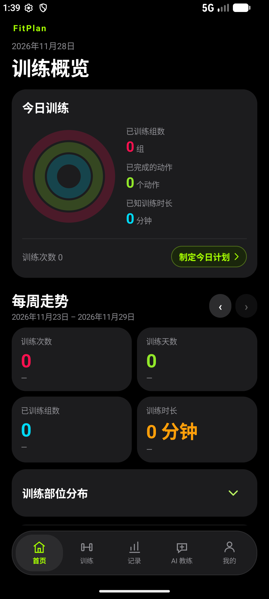 | 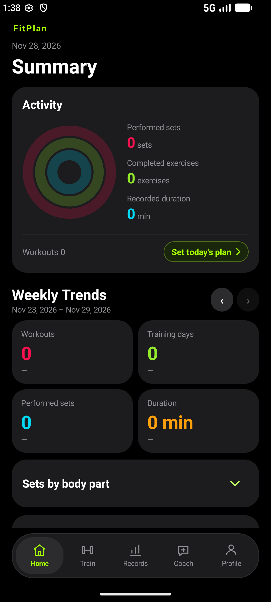 | 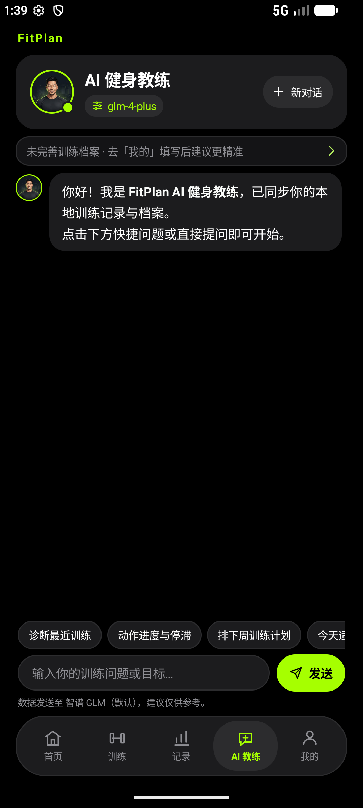 | 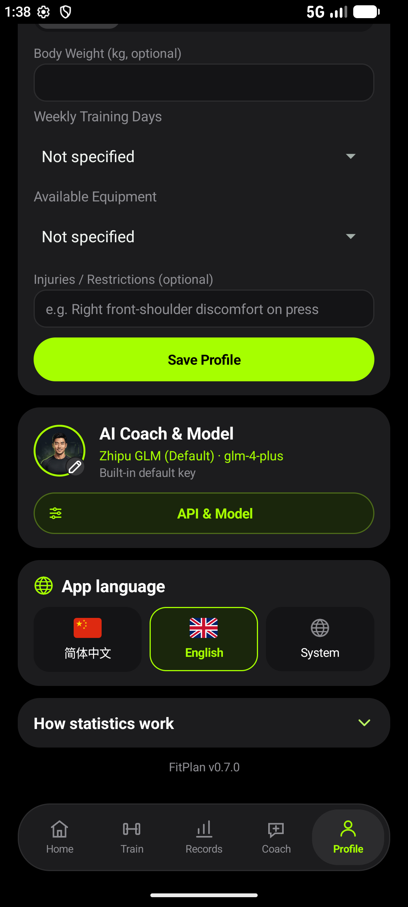 |

## v0.6.10 训练中途调整与历史筛选

2026 年 11 月 27 日更新。

- **训练进行页**。每页显示一个动作，可左右滑动或点箭头切换。完成目标组数后，卡片会保留并显示完成状态。页面支持上下滚动，小屏也能查看计时和结束训练的操作。
- **休息计时**。待机时显示开始按钮和「调整」。默认休息 60 秒，可改为 90 秒或自定义时长，并记住上次设置。倒计时期间只显示「结束休息」。
- **调整动作**。「完成一组」旁新增「调整动作」。可以修改待训练组的重量、次数和组数，也可以选择被占用的器械，将待训练组交给同肌群的替代动作。还可跳过剩余组并选填原因。已记录的组会保留，替换后可滑回原动作查看。三个选项使用带边框和箭头的按钮，整行可点击。
- **今日计划**。重复选择同一个动作时会提示并拦截添加。动作缩略图使用固定高度，点重量「＋」或「−」时，说明文字的变化不会带动图片缩放。
- **训练历史**。按月分组，默认展开最近有记录的月份。支持「最近 7 天」「本月」「自定义日期范围」和「全部日期」。自定义范围包含开始和结束当天，从训练详情返回时保留所选筛选。
- **自定义动作**。可在「训练 → 动作库」删除整个自定义动作及其应用内保存的照片或 GIF。已有计划和训练记录会保留。

应用版本为 0.6.10，versionCode 为 20。调试包未配置 GLM API Key，使用本机 Android 调试签名。覆盖安装需要与已安装版本使用相同签名，仓库中的 v0.6.9 调试包使用另一签名。 [下载 v0.6.10 调试 APK](downloads/FitPlan-v0.6.10-debug.apk) · [SHA256SUMS](downloads/SHA256SUMS)

## v0.6.9 动作演示与自定义动作

2026 年 11 月 27 日更新。

- **内置动作演示**。30 个内置动作均随 APK 附带离线演示视频。在动作库、计划详情或训练中点静态缩略图，即可打开对应动作的循环演示。
- **自定义图片和 GIF**。「添加自定义动作」位于动作库标题旁，在按名称和按肌群两种视图中都可使用。选中的照片或 GIF 保存在应用私有目录，三个页面共用静态缩略图。点照片可放大，点 GIF 可循环播放，也可只保存文字。
- **器械多选**。可同时勾选多件标准器械，并在「其他器械」中填写名称。「无需器械」与具体器械互斥。动作卡显示保存的选择，留空和旧版未填写的动作显示「器械未注明」。
- **按肌群查找自定义动作**。动作库默认按肌群浏览，「全部动作」同时列出内置和自定义动作。新建时可指定目标肌群，点击人体图对应区域即可找到动作。仅记录训练部位的旧动作和新动作会出现在「同部位自定义动作」下。

应用版本为 0.6.9，versionCode 为 19。发布的调试包未配置 GLM API Key，可覆盖本机签名的 v0.6.8 自定义动作测试包。仓库中的正式命名 v0.6.8 调试包使用另一签名。[下载 v0.6.9 调试 APK](downloads/FitPlan-v0.6.9-debug.apk) · [SHA256SUMS](downloads/SHA256SUMS)

## v0.6.8 手动补录训练改版

2026 年 11 月 27 日更新。

- **补录入口**移至「记录」模块右上角，历史与表现分析页都可打开。返回记录页后可继续填写草稿。
- **日期与时长**：所选日期已有训练记录时会提示重选。训练时长可只填小时、只填分钟、两项都填或留空，已取消原 1440 分钟上限。
- **动作录入**：重复添加同一个动作时会提示，并保留已有组数和数据。每页显示一个动作及其所有组数，可左右滑动或点击箭头切换。
- **底部操作**：「添加动作」位于动作区域下方。「放弃补录草稿」与亮绿色的「保存到历史」在底部同一行，确认后才会放弃草稿。

应用版本为 0.6.8 / versionCode 18。调试安装包未配置 GLM API Key，覆盖安装需要与已安装版本使用相同签名。 [下载 v0.6.8 调试 APK](downloads/FitPlan-v0.6.8-debug.apk) · [SHA256SUMS](downloads/SHA256SUMS) · [补录使用说明](docs/MANUAL_HISTORY.md)

## v0.6.7 计划复制、休息计时与返回按钮统一

2026 年 11 月 26 日更新。

- **新建计划自动编号**：默认名称由固定的「我的计划」改为按现有计划自动递增的「我的计划1」「我的计划2」……，避免重名。
- **复制训练计划**：计划页新增「从上次训练复制」「从模板复制」，可分别以最近一次历史训练或任一已有计划为蓝本生成新计划。
- **返回按钮全局统一**：各页面返回按钮统一为「← 返回」箭头符号，字号与颜色一致。
- **休息计时**：新增「自定义休息」按钮，可输入秒数（1–3600 秒）；四个休息按钮改为两行两列的等宽布局。休息倒计时结束会震动一下。

## v0.6.6 首页、今日计划与滚动体验优化

2026 年 11 月 25 日更新，包含 v0.6.5 的训练计划与执行界面改版。

- **今日圆环**：青色指标改为「已完成的动作」，按动作 ID 去重；绿色仍为已训练组数，紫色仍为已知训练时长。三条环加粗约 40%，缩小中心留白，移除中心「今日」文字。
- **周报布局**：摘要保留训练次数、训练天数、已训练组数、训练时长四张卡片；部位分布调整到每日组数图之前。删除首页重复说明、统计口径卡、文字总结和图表下方的数据列表，保留图表点选数值及无障碍说明。训练量仍可在八周趋势中查看。
- **可展开数据模块**：训练部位分布、每天训练了多少组、近八周走势、单动作重量走势默认收起。点击标题或右侧向下箭头展开，再点向上箭头收起；四个模块独立控制，切换周、页面或语言时保留展开状态。此更新仍属于 v0.6.6。
- **切换周不卡顿**：「上一周／下一周／回到本周」只刷新周报，保留阅读位置及上方圆环；连续点击只采用最后一次选择的结果。
- **全局 Logo 动画**：所有页面顶部完整显示 FitPlan；向下浏览时随滚动缩小、淡出并释放顶部空间，滚回顶部恢复。底部导航与固定操作区保持可见。
- **今日计划表单**：原灰色说明改为白色，正文、选项统一为 16sp，时间与状态字段改为同宽纵向排列。可用时间超过 180 分钟时立即弹出提示并标记输入错误；提交时拦截超范围、空值和非整数，10 与 180 分钟均可正常生成计划，修正输入后清除错误。
- **数据兼容**：保留本地 SQLite、原记录 ID、计划和进行中训练快照；不修改训练推荐规则，也不写入演示记录。

下载 [v0.6.6 调试 APK](downloads/FitPlan-v0.6.6-debug.apk)；校验值见 [SHA256SUMS](downloads/SHA256SUMS)。应用版本为 0.6.6 / versionCode 16，使用本机 Windows 调试签名，可覆盖相同签名的旧版。安装包未配置 GLM API Key。

操作与完成动作的统计规则见 [本版说明](docs/DASHBOARD_POLISH.md)，验证范围见 [测试记录](docs/TESTING.md)。

| 中文圆环（固定测试数据） | English（固定测试数据） |
|---|---|
| 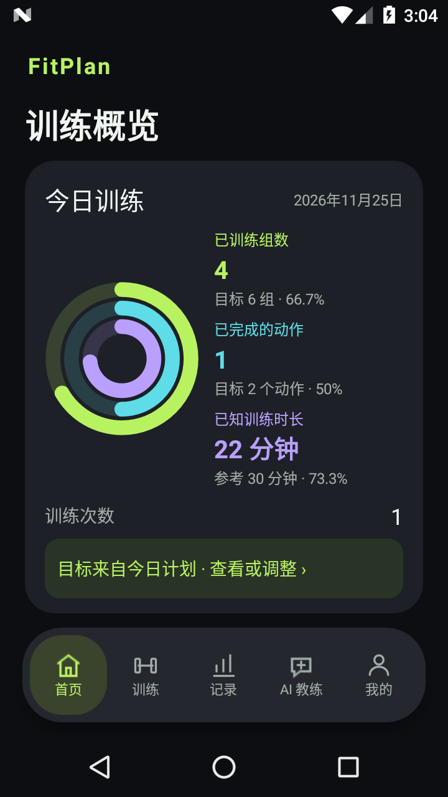 | 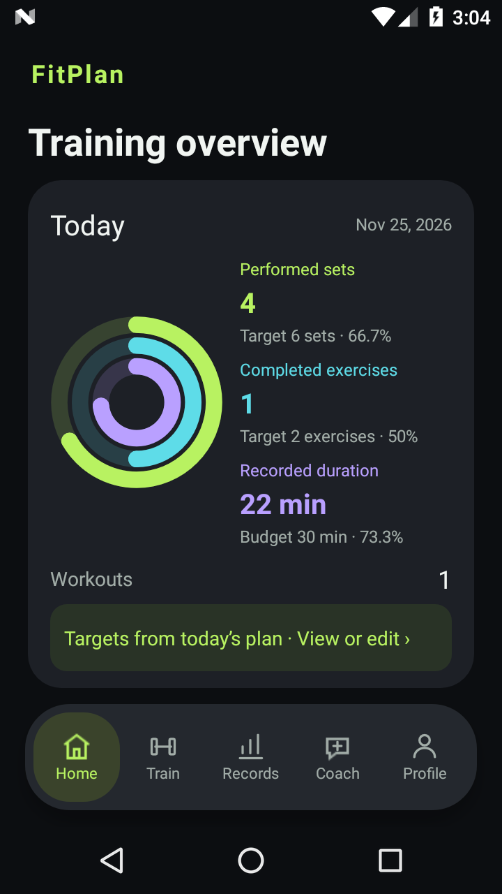 |

四个可展开模块的界面（模拟器测试数据，不随 APK 分发）：

| 默认收起 | 展开部位与每日组数 |
|---|---|
| 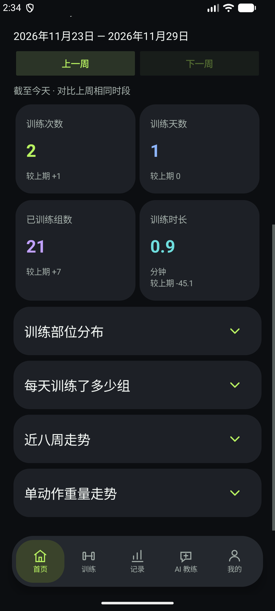 | 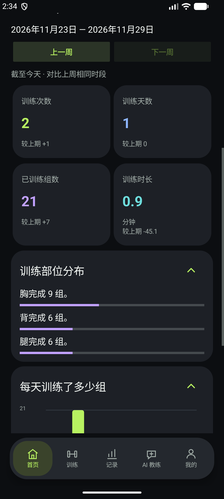 |

[English 展开示例](docs/screenshots/v066-sections-english.png)。

今日计划表单（模拟器界面）：

| 中文 | English |
|---|---|
| 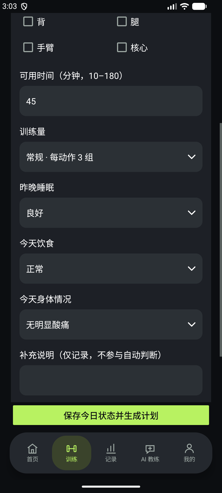 | 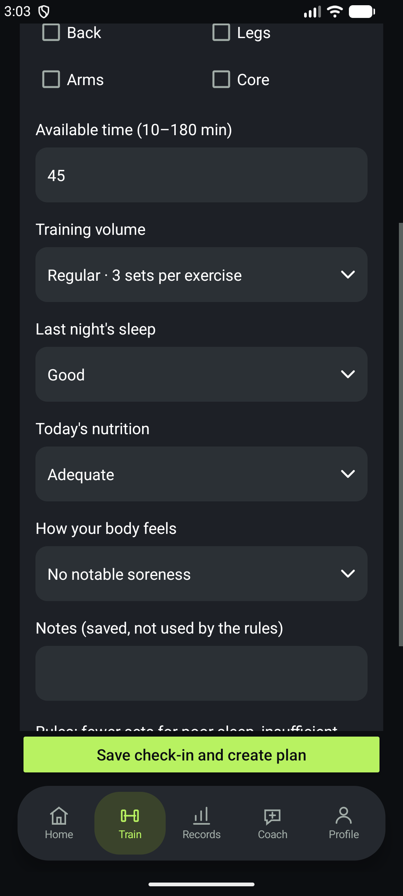 |

[超过 180 分钟的提示示例](docs/screenshots/v066-daily-time-error.png)。

以下为历史版本记录。当前界面和安装包以 v0.6.10 为准。

## v0.6.5 训练计划与执行界面改版

- **训练计划编辑页**：动作列表改为可左右滑动的卡片组，长按动作名可拖拽排序（拖动时其他卡片实时让位），也可用「前移／后移」按钮调整顺序，首个动作不可前移、末个动作不可后移。重量、组数、次数由滑条改为紧凑步进器，可点数值精确输入。
- **训练执行页**：动作改为卡片呈现，图片放大占据右半侧，左下角「完成 X 组」按钮从 0 开始正计数，点一下完成一组、加一，达到目标组数后卡片自动消失。页面改为三板块固定布局（动作卡片、计时器、结束按钮），取消上下滑动，训练时长与休息计时合并显示。

## v0.6.4 今日训练圆环

首页新增三个原生圆环：绿色展示组数，青色展示训练量，紫色展示已知训练时长。目标随当天最新保存的自动计划更新，同时保留实际数值、目标和比例。点击圆环可查看统计说明，点击目标来源可进入今日计划。

没有今日计划时显示“尚无目标”；重量未确认时不计算训练量比例，自重计划不虚构负重目标。时长是计划时间参考，包含休息与离开应用时间；超过目标仍显示真实数值，不作为训练效果评价。支持中英双语与大字体上下排版。

下载 [v0.6.4 调试 APK](downloads/FitPlan-v0.6.4-debug.apk)，详细口径与截图见 [圆环使用说明](docs/DAILY_RINGS.md)。本次 Windows 签名包可覆盖本机 v0.6.3，保留原有数据；未配置 GLM API Key。

## v0.6.3 首页数据看板与训练入口

- **首页**直接展示今日次数、已训练组数、训练量、已知时长及完整周报，可切换历史周和趋势指标。切换历史周不改变顶部今日数据。
- **训练**包含「今日计划／我的计划／动作库」，每日状态填写和生成计划迁移至此。生成后进入计划详情，确认或修改后再开始训练。
- **手动补录**入口改为「训练 → + 补录」，退出可保留草稿，保存后进入历史详情。
- **记录**保留历史和表现分析。五个底部入口、双语、训练快照和本地数据库保持兼容。

下载 [v0.6.3 调试 APK](downloads/FitPlan-v0.6.3-debug.apk)。使用本次 Windows 调试签名，可覆盖本机重建的 v0.6.2；不能保证覆盖仓库内不同签名的旧 APK。安装前请保留数据备份。未配置 GLM API Key，AI 教练页面可查看，联网回答需另行配置。

具体操作与验证范围见 [布局调整说明](docs/MODULE_LAYOUT.md)。

## v0.6.2 手动补录训练

没有在 App 里开始训练，也可以事后补录。在「训练」页右上角点击「+ 补录」，选择实际训练日期和结束时间。训练名称和时长可选填。

- 搜索并添加动作库中的内置或自定义动作。每组可分别填写实际重量、次数和可选难度，并在保存前修改或删除。
- 返回训练页可保留当前草稿。点击「保存到历史」后生成一条独立记录，标记为「手动补录」，可通过现有历史入口修改或删除。
- 历史按实际训练时间排序。补录数据按所选日期计入周报，并纳入 AI 教练的本地训练摘要。原定目标未填写时，实际次数不参与达标判断，也不会触发进阶建议。

使用细节见 [手动补录训练](docs/MANUAL_HISTORY.md)，验证范围见 [测试记录](docs/TESTING.md)。

## v0.6.1 计划编辑与逐组训练

- 自动生成和手动新建的计划均可在动作卡内直接调整重量、组数和每组次数。三个滑条依次排列，带刻度，范围分别为 0–100 kg、1–10 组、1–20 次。拖动重量滑条每步为 0.5 kg，也可点左侧数值精确输入。内置动作在计划和训练页面均显示示例图。
- 开始训练后，标题下首先显示休息计时器。默认从第一个动作开始，用「上一个动作」「下一个动作」切换。每次只显示当前动作的一组待记录内容，标明当前组号和总组数。保存后显示下一组，也可回看和修改已记录组。
- 动作卡提供「减少一组」和「增加一组」。减组时移除最后一个待记录组，已记录组会保留。唯一的待记录组可减到零，页面会提示「此动作已无待记录组」，随后可重新加组。
- 放弃训练时，「一并删除此次训练」默认未勾选。直接确认会将本次训练保存到历史并标记为已放弃，未填写的组标记为未记录；勾选后确认才会删除整次训练。

**闪屏修复**：原先松开计划滑条或在训练中增减组数时，页面会短暂跳回顶部。现在滑条保存后就地更新动作数值、建议和预计时长，增减组数时局部更新当前组、按钮与剩余时间。以上交互已通过真机验证。

## v0.6.0 AI 健身教练

底部导航栏新增第 5 个入口「AI 教练」。页面直接读取本机 `fitplan.db` 中的近 8 周汇总、肌群均组与推拉比例、动作进度与停滞标记、最近 10 次逐组明细、近 7 天每日状态以及动作库，并支持在顶部折叠卡片填写个人训练档案（目标、训练年限、体重、每周可练天数、可用器械、伤病禁忌）。

所有统计数值在本地用纯 Java 确定性计算，再结合 `app/src/main/assets/coach_skill.md` 中的循证训练准则调用智谱 GLM API 生成建议。对话记录仅保留在当前页面内存中，离开或退出后清空；未联网时立即提示「未接入网络，无法召唤你的训练搭子」。首次发送需弹窗确认隐私说明。

详情与 `local.properties` 配置方法见 [AI 健身教练记录](docs/AI_COACH.md)。

## v0.5.1 按肌群浏览动作

在「训练 → 动作库」切换到「按肌群」，可以在同一屏查看人体正面和背面。点击肌群或从下拉列表选择名称，即可高亮该区域，并查看主要训练该肌群的内置动作及示例图。有协同参与的动作时，可展开查看。再次点击已选肌群或选择「清除选择」可返回全部 30 个内置动作。

肌群浏览支持离线使用和中英文显示。例如，选择后肩会列出反向飞鸟和绳索反向飞鸟；选择小腿后侧会提示暂无主要训练动作。自定义动作可在「按名称」中查找。

## v0.5.0 动作库示例图

动作库的 30 个内置动作均配有离线示例图。动作名称、训练部位和器械显示在卡片左侧，右侧显示对应动作的图片。搜索或按训练部位筛选时，图片随动作一起显示。自定义动作继续使用文字卡片。

## v0.4.0 训练反馈与下次建议

逐组记录可沿用同一动作上一组已训练的重量和次数，难度通过“轻松 / 合适 / 吃力”快捷选项填写；未达目标时自动展开原因。提前结束时可为尚未记录的组统一填写原因，已记录内容保留。历史与周报新增表现分析，对同一动作、相同实际重量、组数和目标次数，比较总次数、达标组数、已训练组数与难度。

计划详情按最新历史刷新建议，修改或删除历史后重新计算；生成时的参考快照保留。连续三次可比训练全部达标、难度不超过“合适”时，可选择每组目标增加 1 次；需预览确认，重量保持不变，进行中的训练快照独立保留。这是课程产品规则，尚未通过训练效果验证。

详情、兼容范围和验证结果见 [训练反馈与建议](docs/PROGRESS_FEEDBACK.md)。

## v0.3.0 训练中调整

训练页顶部可以按剩余时间缩短待训练内容；动作卡片内可以选择不可用器械、挑选同类候选，并重新确认替代动作的重量和次数。调整先预览、确认后保存；已训练组保留原动作、组号、重量和次数。调整过程记录在训练及历史中。

详情、限制和测试范围见 [训练中调整记录](docs/WORKOUT_ADJUSTMENTS.md)。

## v0.2.2 今日计划覆盖更新

修改今日状态后再次生成，会更新同一天已有的自动计划及状态记录；旧版本同一天重复生成的自动计划在再次生成时合并为一份。手动创建的计划、其他日期的计划及已开始训练的独立快照继续保留。状态不适合自动安排训练时，保存最新状态并撤下当天旧自动计划。

详情和测试范围见 [今日计划更新记录](docs/DAILY_PLAN_UPDATE.md)。

## v0.2.1 推荐规则修复

- 状态减量先固定正常状态下的动作列表，再减少组数，不用空出的时间增加动作。
- 重量参考只使用同一动作、目标次数一致、完整完成且组数足够的记录，并取各组均已支持的最低重量；没有可比记录时需用户确认。
- 手动修改后显示用户确认值，保存首次修改前的快照；新版生成值与旧版首次确认前的值分开标记。
- 计划详情显示总组数、粗略用时、时间限制及未覆盖部位。旧版自动生成的计划需重新确认重量。

实现、兼容范围和测试结果见 [P0 修复记录](docs/P0_FIXES.md)。

## 功能

- **首页**：已训练组数、已完成动作和时长圆环；四项周摘要，以及可独立展开的部位分布、每日组数与趋势图。周切换保留当前阅读位置和展开状态。
- **训练**提供今日状态和计划生成、我的计划与动作库。30 个内置动作支持搜索和筛选，也可创建自定义动作，其中 14 个内置动作用于补充器械替换候选。
- **记录**提供历史查看、修正、删除及表现分析。在页面右上角点击「+ 补录」，可按实际日期补记一次训练。历史与计划独立保存，周报离线计算。
- **周报**：每日已训练组、部位分布、近八周训练次数/组数/训练量，以及单动作最高实际重量走势。
- **AI 教练**：基于本地训练统计与循证 Skill 的多轮问答建议、可折叠个人训练档案、快捷提问与离线拦截提示。
- **我的**：简体中文、English、跟随系统；用户输入保持原文，明确标记的示例数据有双语标题。

无账号、无云同步。数据库保存在每台设备本地，卸载应用会删除数据；仅在「AI 教练」主动发送提问时，会将本地训练摘要与档案发送至智谱 GLM 生成建议。

## 安装体验

[下载当前 v0.6.10 调试 APK](downloads/FitPlan-v0.6.10-debug.apk)。本包未配置 GLM API Key。历史调试包继续保留，完整文件名及校验值见 [SHA256SUMS](downloads/SHA256SUMS)。这些包用于开发与课程演示，不是应用商店发布包。

v0.5.0 至 v0.6.1 的安装包均使用同一 Windows 调试密钥签名，可从这些旧版覆盖更新至 v0.6.1。仓库中的 v0.4.0 APK 使用另一把密钥，Android 会拒绝用此包直接覆盖安装。需要保留旧版训练记录时，可用另一台设备或模拟器体验新版。

v0.6.2 下载包使用本次 macOS 构建的调试签名，可以覆盖使用同一密钥的本机旧版。使用上述 Windows 签名包的设备需要用相同密钥重新构建 v0.6.2，或在另一台设备上体验新版。

覆盖安装相同签名版本可保留数据。真机和模拟器不共享历史；安装包本身不包含演示训练记录。

本机 v0.2.1 至 v0.4.0 使用相同的 Mac 调试密钥，可覆盖更新；与原 v0.2 APK 的签名不同。已使用独立的 `FitPlanP0` 模拟器运行新版，并复制、核对了原模拟器的数据。两个模拟器后续新增数据分别保存。

## 在 Android Studio 运行

1. 克隆仓库并用 Android Studio 打开项目根目录。Windows 上请使用不含中文等非 ASCII 字符的目录，例如 `C:\AndroidProjects\FitPlan`，避免 Android Gradle Plugin 的路径检查失败。
2. 安装 Android SDK Platform 37.0 与 Build-Tools 36.0.0，并使用兼容 Android Gradle Plugin 9.3.0、Gradle 9.6.0 的 JDK。当前版本在 Windows、JDK 25 构建环境验证。
3. 等待 Gradle Sync 完成。SDK 路径由本机 Android Studio 配置，`local.properties` 不提交。
4. 选择 API 24 以上的安卓设备或模拟器，运行 `app`。

构建脚本使用 Kotlin DSL，应用业务与界面代码使用 Java。Java 源码兼容级别为 11，最低 Android 版本为 7.0（API 24）。仓库保留课程环境使用的阿里云 Maven 镜像及官方仓库，不包含本机代理地址或凭据。

```powershell
# Windows: configure JAVA_HOME to your compatible JDK first
.\gradlew.bat assembleDebug testDebugUnitTest lintDebug --max-workers=2
# With an authorized Android device/emulator connected
.\gradlew.bat connectedDebugAndroidTest --max-workers=2
```

macOS/Linux 使用 `./gradlew`。APK 构建输出位于 `app/build/outputs/apk/debug/`。

## 项目结构

| 位置 | 内容 |
|---|---|
| `app/src/main/java/com/example/fitplan` | 五入口页面、训练记录、SQLite、规则和周报计算 |
| `app/src/main/res` | XML 布局、主题、中文和英文资源 |
| `app/src/test` | 推荐规则、周报计算单元测试 |
| `app/src/androidTest` | 数据持久化、界面流程与双语设备测试 |
| `docs` | 设计、验证结果、示例截图 |
| `tools` | 可选的模拟器测试数据生成工具 |
| `downloads` | 当前可安装调试 APK 和 SHA-256 校验值 |

## 统计与推荐说明

周报以设备本地时区的周一至周日为一周，根据训练结束时间归属。仅已训练组及其实际次数参与统计，未达目标的已训练组也会计入；零已训练组的记录不计训练次数。达标组是实际次数达到目标的已训练组。训练量为实际重量 × 次数之和，自重动作仍计入已训练组数。时长包含休息和离开应用的时间。

首页「已完成的动作」只统计已结束并保存的训练：某动作在一次训练中的全部计划组完成后计为 1 个，同一天按动作 ID 去重；同名但不同 ID 不合并。未完成或跳过的组不算完成，补录按实际记录的组判断；目标为当天最新自动计划中的不同动作数。

本周与上周相同时段比较，完整历史周与前一完整周比较。单动作按 ID 聚合，避免同名动作混在一起；没有训练的日期不补成 0。修改历史后周报重新计算。

推荐规则是可调整的课程项目规则：根据今日状态减少组数且不补入新动作，参考最近可比完整记录中各组均已支持的重量；不额外自动加重。缺少可比记录的动作需用户确认重量（自重可确认为 0）。逐组主观难度与未达标原因用于本地表现分析，但不能视为完整训练表现评估。规则不等同于经过验证的个人健身处方。

## 历史版本截图

下方历史和趋势截图包含带标记的**演示数据**，不是用户真实成绩。

| 中文首页 | 英文历史 |
|---|---|
| 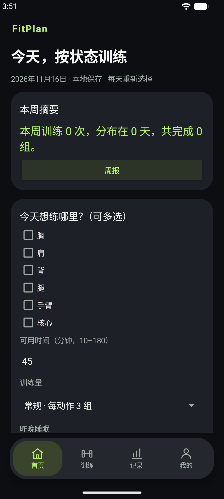 |  |

| 周报 | 近八周走势 |
|---|---|
|  |  |

详细验证范围见 [测试记录](docs/TESTING.md)，模拟器数据生成说明见 [演示数据](docs/DEMO_DATA.md)。

## 项目背景

项目功能构思参考 [openGym](https://github.com/DuarteSantos8/openGym)，FitPlan 使用 Java 原生 Android 实现。30 个内置动作的示例图片和演示视频取自 openGym 动作资源库。仓库尚未指定开源许可证；私有仓库访问权限不等于开源授权。
