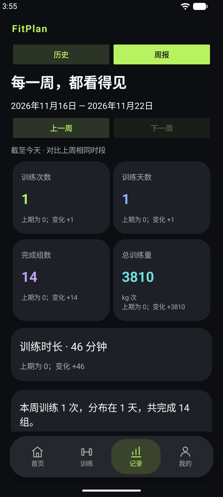

# FitPlan

Java 原生 Android 训练记录应用。核心训练记录、规则推荐与周报完全离线运行，并内置可选联网的 AI 健身教练，支持每日状态填写、训练计划、逐组记录、休息计时、历史修正、中英双语周报与基于本地训练数据的 AI 建议。

## v0.6.2 手动补录训练

没有在 App 里开始训练，也可以事后补录。在「记录」页右上角点击「+ 补录」，选择实际训练日期和结束时间。训练名称和时长可选填。

- 搜索并添加动作库中的内置或自定义动作。每组可分别填写实际重量、次数和可选难度，并在保存前修改或删除。
- 返回记录页可保留当前草稿。点击「保存到历史」后生成一条独立记录，标记为「手动补录」，可通过现有历史入口修改或删除。
- 历史按实际训练时间排序。补录数据按所选日期计入周报，并纳入 AI 教练的本地训练摘要。原定目标未填写时，实际次数不参与达标判断，也不会触发进阶建议。

使用细节见 [手动补录训练](docs/MANUAL_HISTORY.md)，验证范围见 [测试记录](docs/TESTING.md)。

## v0.6.1 计划编辑与逐组训练

- 自动生成和手动新建的计划均可在动作卡内直接调整重量、组数和每组次数。三个滑条依次排列，带刻度，范围分别为 0–100 kg、1–10 组、1–20 次。拖动重量滑条每步为 0.5 kg，也可点左侧数值精确输入。内置动作在计划和训练页面均显示示例图。
- 开始训练后，标题下首先显示休息计时器。默认从第一个动作开始，用「上一个动作」「下一个动作」切换。每次只显示当前动作的一组待记录内容，标明当前组号和总组数。保存后显示下一组，也可回看和修改已记录组。
- 动作卡提供「减少一组」和「增加一组」。减组时移除最后一个待记录组，已记录组会保留。唯一的待记录组可减到零，页面会提示「此动作已无待记录组」，随后可重新加组。
- 放弃训练时，「一并删除此次训练」默认未勾选。直接确认会将本次训练保存到历史并标记为已放弃，未填写的组标记为未记录；勾选后确认才会删除整次训练。

**闪屏修复**：原先松开计划滑条或在训练中增减组数时，页面会短暂跳回顶部。现在滑条保存后就地更新动作数值、建议和预计时长，增减组数时局部更新当前组、按钮与剩余时间。以上交互已通过真机验证。

## v0.6.0 AI 健身教练

底部导航栏新增第 5 个入口「AI 教练」。页面直接读取本机 `fitplan.db` 中的近 8 周汇总、肌群均组与推拉比例、动作进度与停滞标记、最近 10 次逐组明细、近 7 天每日状态以及动作库，并支持在顶部折叠卡片填写个人训练档案（目标、训练年限、体重、每周可练天数、可用器械、伤病禁忌）。

所有统计数值在本地用纯 Java 确定性计算，再结合 `app/src/main/assets/coach_skill.md` 中的循证训练准则调用智谱 GLM API 生成建议。对话记录仅保留在当前页面内存中，离开或退出后清空；未联网时立即提示「未接入网络，无法召唤你的训练搭子」。首次发送需弹窗确认隐私说明。

详情与 `local.properties` 配置方法见 [AI 健身教练记录](docs/AI_COACH.md)。

## v0.5.1 按肌群浏览动作

在「训练 → 动作库」切换到「按肌群」，可以在同一屏查看人体正面和背面。点击肌群或从下拉列表选择名称，即可高亮该区域，并查看主要训练该肌群的内置动作及示例图。有协同参与的动作时，可展开查看。再次点击已选肌群或选择「清除选择」可返回全部 30 个内置动作。

肌群浏览支持离线使用和中英文显示。例如，选择后肩会列出反向飞鸟和绳索反向飞鸟；选择小腿后侧会提示暂无主要训练动作。自定义动作可在「按名称」中查找。

## v0.5.0 动作库示例图

动作库的 30 个内置动作均配有离线示例图。动作名称、训练部位和器械显示在卡片左侧，右侧显示对应动作的图片。搜索或按训练部位筛选时，图片随动作一起显示。自定义动作继续使用文字卡片。

## v0.4.0 训练反馈与下次建议

逐组记录可沿用同一动作上一组已训练的重量和次数，难度通过“轻松 / 合适 / 吃力”快捷选项填写；未达目标时自动展开原因。提前结束时可为尚未记录的组统一填写原因，已记录内容保留。历史与周报新增表现分析，对同一动作、相同实际重量、组数和目标次数，比较总次数、达标组数、已训练组数与难度。

计划详情按最新历史刷新建议，修改或删除历史后重新计算；生成时的参考快照保留。连续三次可比训练全部达标、难度不超过“合适”时，可选择每组目标增加 1 次；需预览确认，重量保持不变，进行中的训练快照独立保留。这是课程产品规则，尚未通过训练效果验证。

详情、兼容范围和验证结果见 [训练反馈与建议](docs/PROGRESS_FEEDBACK.md)。

## v0.3.0 训练中调整

训练页顶部可以按剩余时间缩短待训练内容；动作卡片内可以选择不可用器械、挑选同类候选，并重新确认替代动作的重量和次数。调整先预览、确认后保存；已训练组保留原动作、组号、重量和次数。调整过程记录在训练及历史中。

详情、限制和测试范围见 [训练中调整记录](docs/WORKOUT_ADJUSTMENTS.md)。

## v0.2.2 今日计划覆盖更新

修改今日状态后再次生成，会更新同一天已有的自动计划及状态记录；旧版本同一天重复生成的自动计划在再次生成时合并为一份。手动创建的计划、其他日期的计划及已开始训练的独立快照继续保留。状态不适合自动安排训练时，保存最新状态并撤下当天旧自动计划。

详情和测试范围见 [今日计划更新记录](docs/DAILY_PLAN_UPDATE.md)。

## v0.2.1 推荐规则修复

- 状态减量先固定正常状态下的动作列表，再减少组数，不用空出的时间增加动作。
- 重量参考只使用同一动作、目标次数一致、完整完成且组数足够的记录，并取各组均已支持的最低重量；没有可比记录时需用户确认。
- 手动修改后显示用户确认值，保存首次修改前的快照；新版生成值与旧版首次确认前的值分开标记。
- 计划详情显示总组数、粗略用时、时间限制及未覆盖部位。旧版自动生成的计划需重新确认重量。

实现、兼容范围和测试结果见 [P0 修复记录](docs/P0_FIXES.md)。

## 功能

- **首页**：睡眠、饮食、酸痛、训练部位与可用时间；顶部继续训练、固定生成按钮，以及表单下方的简洁本周摘要。
- **训练**：计划和动作库独立展示；30 个内置动作，支持搜索、筛选与自定义动作，其中新增 14 个用于补充器械替换候选。
- **记录**：查看历史、手动补录训练及修改实际重量、组数和次数。历史与计划独立保存，周报离线计算。
- **周报**：每日已训练组、部位分布、近八周训练次数/组数/训练量，以及单动作最高实际重量走势。
- **AI 教练**：基于本地训练统计与循证 Skill 的多轮问答建议、可折叠个人训练档案、快捷提问与离线拦截提示。
- **我的**：简体中文、English、跟随系统；用户输入保持原文，明确标记的示例数据有双语标题。

无账号、无云同步。数据库保存在每台设备本地，卸载应用会删除数据；仅在「AI 教练」主动发送提问时，会将本地训练摘要与档案发送至智谱 GLM 生成建议。

## 安装体验

[下载 v0.6.2 调试 APK](downloads/FitPlan-v0.6.2-debug.apk)（本包未配置 GLM API Key）。[v0.6.1](downloads/FitPlan-v0.6.1-debug.apk)、[v0.6.0](downloads/FitPlan-v0.6.0-debug.apk)、[v0.5.1](downloads/FitPlan-v0.5.1-debug.apk)、[v0.5.0](downloads/FitPlan-v0.5.0-debug.apk)、[v0.4.0](downloads/FitPlan-v0.4.0-debug.apk)、[v0.3.0](downloads/FitPlan-v0.3.0-debug.apk)、[v0.2.2](downloads/FitPlan-v0.2.2-debug.apk)、[v0.2.1](downloads/FitPlan-v0.2.1-debug.apk) 和 [原 v0.2](downloads/FitPlan-v0.2-debug.apk) 安装包继续保留，校验值在 [SHA256SUMS](downloads/SHA256SUMS)。这些包用于开发与课程演示，不是应用商店发布包。

v0.5.0 至 v0.6.1 的安装包均使用同一 Windows 调试密钥签名，可从这些旧版覆盖更新至 v0.6.1。仓库中的 v0.4.0 APK 使用另一把密钥，Android 会拒绝用此包直接覆盖安装。需要保留旧版训练记录时，可用另一台设备或模拟器体验新版。

v0.6.2 下载包使用本次 macOS 构建的调试签名，可以覆盖使用同一密钥的本机旧版。使用上述 Windows 签名包的设备需要用相同密钥重新构建 v0.6.2，或在另一台设备上体验新版。

覆盖安装相同签名版本可保留数据。真机和模拟器不共享历史；安装包本身不包含演示训练记录。

本机 v0.2.1 至 v0.4.0 使用相同的 Mac 调试密钥，可覆盖更新；与原 v0.2 APK 的签名不同。已使用独立的 `FitPlanP0` 模拟器运行新版，并复制、核对了原模拟器的数据。两个模拟器后续新增数据分别保存。

## 在 Android Studio 运行

1. 克隆仓库并用 Android Studio 打开项目根目录。Windows 上请使用不含中文等非 ASCII 字符的目录，例如 `C:\AndroidProjects\FitPlan`，避免 Android Gradle Plugin 的路径检查失败。
2. 安装 Android SDK Platform 37.0 与 Build-Tools 36.0.0，并使用兼容 Android Gradle Plugin 9.5.1、Gradle 9.6.0 的 JDK。v0.2.1 在 macOS arm64、Temurin JDK 25、Gradle 9.6.0 上构建验证。
3. 等待 Gradle Sync 完成。SDK 路径由本机 Android Studio 配置，`local.properties` 不提交。
4. 选择 API 24 以上的安卓设备或模拟器，运行 `app`。

构建脚本使用 Kotlin DSL，应用业务与界面代码使用 Java。Java 源码兼容级别为 11，最低 Android 版本为 7.0（API 24）。仓库保留课程环境使用的阿里云 Maven 镜像及官方仓库，不包含本机代理地址或凭据。

```powershell
# Windows: configure JAVA_HOME to your compatible JDK first
.\gradlew.bat assembleDebug testDebugUnitTest lintDebug --max-workers=2
# With an authorized Android device/emulator connected
.\gradlew.bat connectedDebugAndroidTest --max-workers=2
```

macOS/Linux 使用 `./gradlew`。APK 构建输出位于 `app/build/outputs/apk/debug/`。

## 项目结构

| 位置 | 内容 |
|---|---|
| `app/src/main/java/com/example/fitplan` | 四入口页面、训练记录、SQLite、规则和周报计算 |
| `app/src/main/res` | XML 布局、主题、中文和英文资源 |
| `app/src/test` | 推荐规则、周报计算单元测试 |
| `app/src/androidTest` | 数据持久化、界面流程与双语设备测试 |
| `docs` | 设计、验证结果、示例截图 |
| `tools` | 可选的模拟器测试数据生成工具 |
| `downloads` | 当前可安装调试 APK 和 SHA-256 校验值 |

## 统计与推荐说明

周报以设备本地时区的周一至周日为一周，根据训练结束时间归属。仅已训练组及其实际次数参与统计，未达目标的已训练组也会计入；零已训练组的记录不计训练次数。达标组是实际次数达到目标的已训练组。训练量为实际重量 × 次数之和，自重动作仍计入已训练组数。时长包含休息和离开应用的时间。

本周与上周相同时段比较，完整历史周与前一完整周比较。单动作按 ID 聚合，避免同名动作混在一起；没有训练的日期不补成 0。修改历史后周报重新计算。

推荐规则是可调整的课程项目规则：根据今日状态减少组数且不补入新动作，参考最近可比完整记录中各组均已支持的重量；不额外自动加重。缺少可比记录的动作需用户确认重量（自重可确认为 0）。目前没有器械变体和主观难度字段，不能视为完整训练表现评估。规则不等同于经过验证的个人健身处方。

## 截图

下方历史和趋势截图包含带标记的**演示数据**，不是用户真实成绩。

| 中文首页 | 英文历史 |
|---|---|
|  |  |

| 周报 | 近八周走势 |
|---|---|
|  |  |

详细验证范围见 [测试记录](docs/TESTING.md)，模拟器数据生成说明见 [演示数据](docs/DEMO_DATA.md)。

## 项目背景

项目功能构思参考 [openGym](https://github.com/DuarteSantos8/openGym)，本仓库为 Java 原生 Android 实现，未导入其动作图片、视频或服务端代码。仓库尚未指定开源许可证；私有仓库访问权限不等于开源授权。
