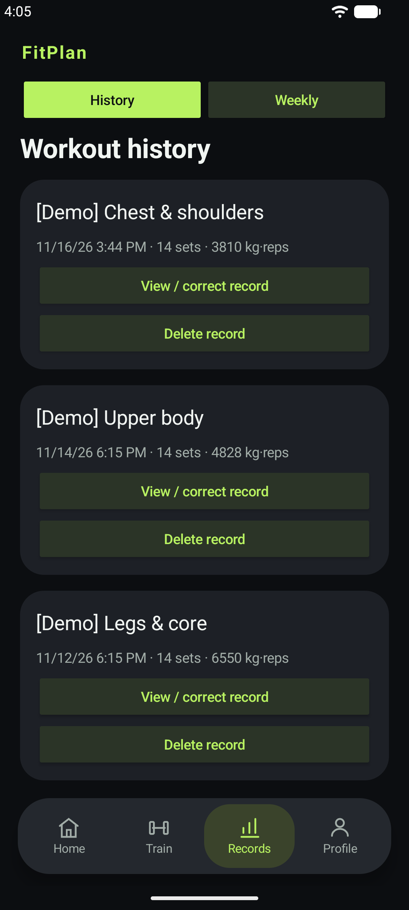
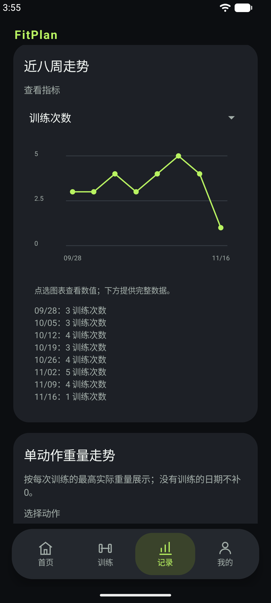

# FitPlan

Java 原生 Android 离线训练记录应用。支持每日状态填写、规则推荐、训练计划、逐组记录、休息计时、历史修正，以及中英双语周报和趋势图。

## v0.4.0 训练反馈与下次建议

逐组记录“轻松 / 合适 / 吃力”和未达目标原因；提前结束时可为尚未记录的组统一填写原因，已记录内容保留。历史与周报新增表现分析，对同一动作、相同实际重量、组数和目标次数，比较总次数、达标组数、已训练组数与难度。

下次计划显示可解释的建议。连续三次可比训练全部达标、难度不超过“合适”时，可选择每组目标增加 1 次；需预览确认，重量保持不变，进行中的训练快照独立保留。这是课程产品规则，尚未通过训练效果验证。

详情、兼容范围和验证结果见 [训练反馈与建议](docs/PROGRESS_FEEDBACK.md)。

## v0.3.0 训练中调整

训练页顶部可以按剩余时间缩短未完成内容；动作卡片内可以选择不可用器械、挑选同类候选，并重新确认替代动作的重量和次数。调整先预览、确认后保存；已完成组保留原动作、组号、重量和次数。调整过程记录在训练及历史中。

详情、限制和测试范围见 [训练中调整记录](docs/WORKOUT_ADJUSTMENTS.md)。

## v0.2.2 今日计划覆盖更新

修改今日状态后再次生成，会更新同一天已有的自动计划及状态记录；旧版本同一天重复生成的自动计划在再次生成时合并为一份。手动创建的计划、其他日期的计划及已开始训练的独立快照继续保留。状态不适合自动安排训练时，保存最新状态并撤下当天旧自动计划。

详情和测试范围见 [今日计划更新记录](docs/DAILY_PLAN_UPDATE.md)。

## v0.2.1 推荐规则修复

- 状态减量先固定正常状态下的动作列表，再减少组数，不用空出的时间增加动作。
- 重量参考只使用同一动作、目标次数一致、完整完成且组数足够的记录，并取各组均已支持的最低重量；没有可比记录时需用户确认。
- 手动修改后显示用户确认值，保存首次修改前的快照；新版生成值与旧版首次确认前的值分开标记。
- 计划详情显示总组数、粗略用时、时间限制及未覆盖部位。旧版自动生成的计划需重新确认重量。

实现、兼容范围和测试结果见 [P0 修复记录](docs/P0_FIXES.md)。

## 功能

- **首页**：睡眠、饮食、酸痛、训练部位与可用时间；本周摘要和继续训练。
- **训练**：计划和动作库独立展示；30 个内置动作，支持搜索、筛选与自定义动作，其中新增 14 个用于补充器械替换候选。
- **记录**：实际重量、组数和次数；历史与计划独立保存，周报离线计算。
- **周报**：每日完成组、部位分布、近八周训练次数/组数/训练量，以及单动作最高实际重量走势。
- **我的**：简体中文、English、跟随系统；用户输入保持原文，明确标记的示例数据有双语标题。

无账号、无服务器、无多设备同步。数据库保存在每台设备本地；卸载应用会删除数据。

## 安装体验

[下载 v0.4.0 调试 APK](downloads/FitPlan-v0.4.0-debug.apk)。[v0.3.0](downloads/FitPlan-v0.3.0-debug.apk)、[v0.2.2](downloads/FitPlan-v0.2.2-debug.apk)、[v0.2.1](downloads/FitPlan-v0.2.1-debug.apk) 和 [原 v0.2](downloads/FitPlan-v0.2-debug.apk) 安装包继续保留，校验值在 [SHA256SUMS](downloads/SHA256SUMS)。这些包用于开发与课程演示，不是应用商店发布包。

覆盖安装相同签名版本可保留数据。真机和模拟器不共享历史；安装包本身不包含演示训练记录。

本机 v0.2.1 至 v0.4.0 使用相同的 Mac 调试密钥，可覆盖更新；与原 v0.2 APK 的签名不同。已使用独立的 `FitPlanP0` 模拟器运行新版，并复制、核对了原模拟器的数据。两个模拟器后续新增数据分别保存。

## 在 Android Studio 运行

1. 克隆仓库并用 Android Studio 打开项目根目录。Windows 上请使用不含中文等非 ASCII 字符的目录，例如 `C:\AndroidProjects\FitPlan`，避免 Android Gradle Plugin 的路径检查失败。
2. 安装 Android SDK Platform 37.0 与 Build-Tools 36.0.0，并使用兼容 Android Gradle Plugin 9.5.1、Gradle 9.6.0 的 JDK。v0.2.1 在 macOS arm64、Temurin JDK 25、Gradle 9.6.0 上构建验证。
3. 等待 Gradle Sync 完成。SDK 路径由本机 Android Studio 配置，`local.properties` 不提交。
4. 选择 API 24 以上的安卓设备或模拟器，运行 `app`。

构建脚本使用 Kotlin DSL，应用业务与界面代码使用 Java。Java 源码兼容级别为 11，最低 Android 版本为 7.0（API 24）。仓库保留课程环境使用的阿里云 Maven 镜像及官方仓库，不包含本机代理地址或凭据。

```powershell
# Windows: configure JAVA_HOME to your compatible JDK first
.\gradlew.bat assembleDebug testDebugUnitTest lintDebug --max-workers=2
# With an authorized Android device/emulator connected
.\gradlew.bat connectedDebugAndroidTest --max-workers=2
```

macOS/Linux 使用 `./gradlew`。APK 构建输出位于 `app/build/outputs/apk/debug/`。

## 项目结构

| 位置 | 内容 |
|---|---|
| `app/src/main/java/com/example/fitplan` | 四入口页面、训练记录、SQLite、规则和周报计算 |
| `app/src/main/res` | XML 布局、主题、中文和英文资源 |
| `app/src/test` | 推荐规则、周报计算单元测试 |
| `app/src/androidTest` | 数据持久化、界面流程与双语设备测试 |
| `docs` | 设计、验证结果、示例截图 |
| `tools` | 可选的模拟器测试数据生成工具 |
| `downloads` | 当前可安装调试 APK 和 SHA-256 校验值 |

## 统计与推荐说明

周报以设备本地时区的周一至周日为一周，根据训练结束时间归属。仅已完成组参与统计；零完成组训练不计次数。训练量为实际重量 × 次数之和，自重动作仍计入完成组数。时长包含休息和离开应用的时间。

本周与上周相同时段比较，完整历史周与前一完整周比较。单动作按 ID 聚合，避免同名动作混在一起；没有训练的日期不补成 0。修改历史后周报重新计算。

推荐规则是可调整的课程项目规则：根据今日状态减少组数且不补入新动作，参考最近可比完整记录中各组均已支持的重量；不额外自动加重。缺少可比记录的动作需用户确认重量（自重可确认为 0）。目前没有器械变体和主观难度字段，不能视为完整训练表现评估。规则不等同于经过验证的个人健身处方。

## 截图

下方历史和趋势截图包含带标记的**演示数据**，不是用户真实成绩。

| 中文首页 | 英文历史 |
|---|---|
|  |  |

| 周报 | 近八周走势 |
|---|---|
|  |  |

详细验证范围见 [测试记录](docs/TESTING.md)，模拟器数据生成说明见 [演示数据](docs/DEMO_DATA.md)。

## 项目背景

项目功能构思参考 [openGym](https://github.com/DuarteSantos8/openGym)，本仓库为 Java 原生 Android 实现，未导入其动作图片、视频或服务端代码。仓库尚未指定开源许可证；私有仓库访问权限不等于开源授权。
