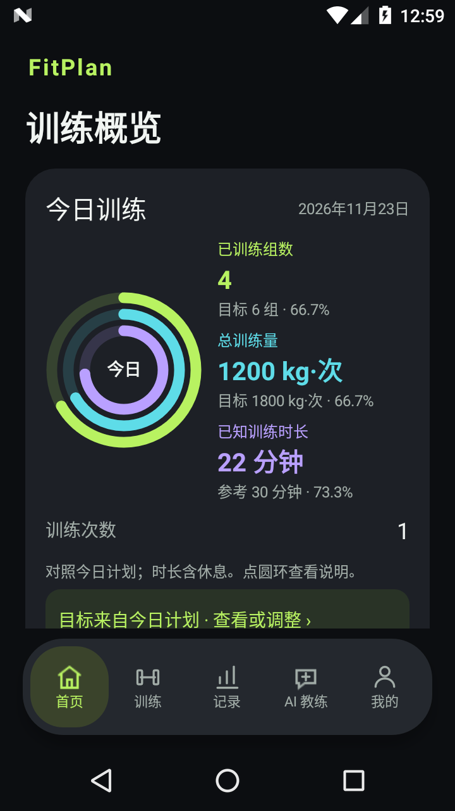
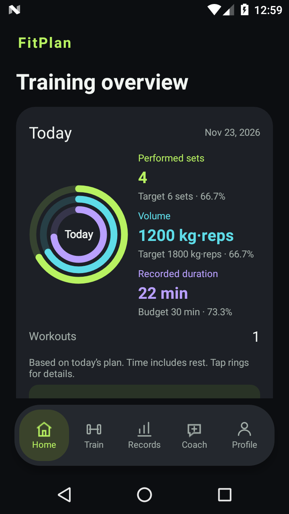

# FitPlan v0.6.4 今日训练圆环

## 使用方法

在「训练 → 今日计划」生成当天计划，确认动作重量后保存。回到首页即可看到三个圆环及对应的实际值、目标值和比例。点击圆环查看统计解释；点击卡片底部的目标来源查看或调整计划。没有当天自动计划时，底部入口打开今日计划表单。

| 圆环 | 今日实际值 | 计划参照 |
|---|---|---|
| 绿色 · 组数 | 历史中今天已训练的有效组数 | 今日计划的组数总和 |
| 青色 · 训练量 | 每个有效组的实际重量 × 实际次数之和 | 每个动作的重量 × 组数 × 每组次数之和 |
| 紫色 · 时长 | 今天已保存训练的已知起止时长 | 今日计划的分钟数预算 |

实际值沿用周报统计口径，按照设备本地日期及训练结束时间汇总所有今日历史，包括手动补录；尚未结束的训练不计入。目标读取最新保存的当天自动模板，不读取正在训练的独立快照，也不自动猜测手动计划的日期。旧计划的 checkin.day 可用于兼容读取。修改计划后重新进入首页会刷新目标，不修改已有历史。

## 特殊状态

- 没有今日计划、计划没有动作或目标不可用时，显示“尚无目标”，继续展示实际数值。
- 计划重量待确认时，训练量显示“目标重量待确认”，青色圆环不显示比例。可以点击目标来源到计划详情确认。
- 全自重计划不设置负重比例；自重实际组数继续计入绿色圆环。
- 圆环填充最多一圈，数值仍可超过 100%。今天多次训练可能超过单份计划，因此圆环不是每个计划的完成检查，也不是训练效果评价。
- 时长包含休息和离开应用时间，未填写的时长不推算；紫色圆环仅表示计划时间的使用比例，不鼓励为了闭环延长训练。
- 所选历史周不改变今日圆环。保存、修正或删除历史后，返回首页重新汇总。

## 显示与兼容

原生 Java Canvas 绘制、短入场动画、可读数值和无障碍描述，不接入健康平台。中文、English 与跟随系统共用既有语言设置。字体比例大于 1.2 或屏幕宽度小于 320dp 时改为上下排列，页面可滚动；底部导航沿用现有安全区域布局。

数据库表结构、记录 ID、推荐规则与训练快照保持兼容。目标读取和历史汇总仍在后台线程执行。

## 预览

下方是独立 API 24 测试设备中的固定测试数据：计划 6 组、1800 kg·次、30 分钟；实际 4 组、1200 kg·次、22 分钟，仅用于展示。测试后自动删除，不打包进 APK。

| 中文 | English |
|---|---|
|  |  |

日常 API 37 模拟器的[首页截图](screenshots/v064-home-zh.png)使用此前已有的演示记录；其设备日期仍为 2026-11-16，本次没有调整设备时钟。已有旧计划重量未确认，因此该截图中青色环为空，这是预期状态。

## 验证与交付

版本 0.6.4 / versionCode 14。本地分支 feature/daily-rings-v0.6.4，基于 v0.6.3 的 1b0b95a；本次通过正常快进更新至 main，保留原有提交历史与功能分支。安装包使用本机 Windows 调试签名。

68 项单元测试和 API 24 的 10 项设备测试通过；另以 130% 字体重复中英圆环场景，检查上下排版。API 37 日常模拟器已覆盖安装、启动并通过实际点击查看圆环说明；升级前后 59 条数据库记录的 ID、类型、JSON 与更新时间逐项一致。详见 [验证记录](TESTING.md)。
