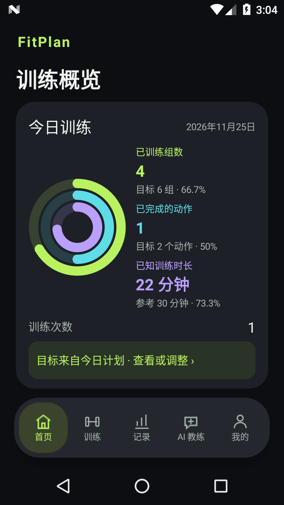
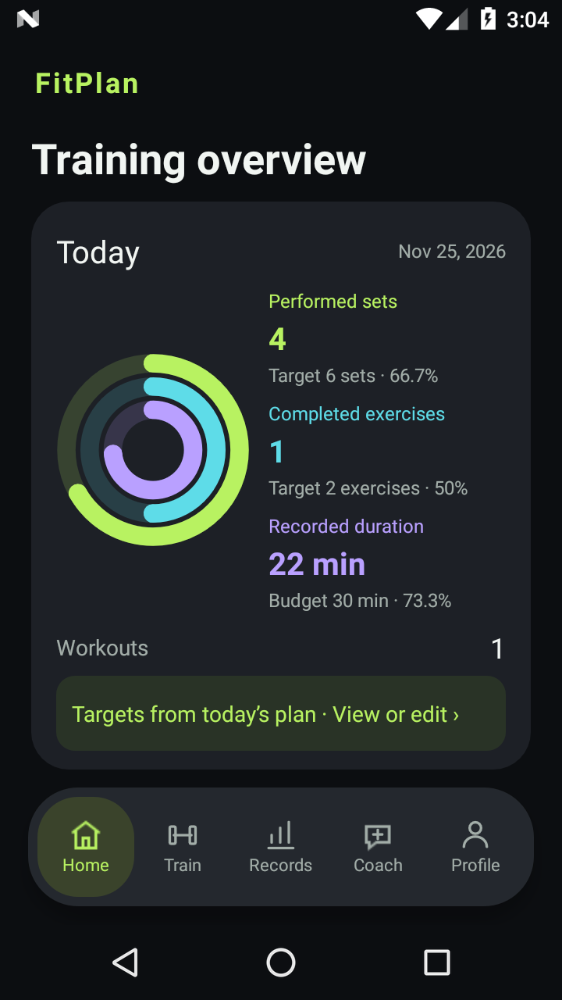

# FitPlan v0.6.6 首页、今日计划与滚动体验

发布于 2026 年 11 月 25 日。版本 0.6.6 / versionCode 16，沿用 Java 原生界面和本地数据库。

## 今日训练

| 圆环 | 实际值 | 目标 |
|---|---|---|
| 绿色 | 今天已保存历史中的有效已训练组 | 当天最新自动计划的组数 |
| 青色 | 今天已完成的不同动作数 | 当天最新自动计划的不同动作数 |
| 紫色 | 今天已保存训练的已知时长 | 当天计划分钟数 |

按设备本地日期和训练结束时间汇总。一个动作必须在某次训练中完成全部计划组才计入青色圆环；同一动作 ID 在同一训练中有多行时，各行均需完成。跨训练只要有一次完整完成，该 ID 当天计 1 次；同名但不同 ID 分别计数。未完成、跳过或缺失的组不算完成。补录按实际记录的组判断；缺少计划组数的旧记录按已有记录组数兼容读取，不改写原数据。

自重动作正常计入组数与动作数；重量待确认不会阻止有效动作目标的显示。没有今日计划或目标无效时显示「尚无目标」，不虚构百分比。超过目标的数值继续展示，圆环最多填满一圈。时长包含休息和离开应用时间，未知时长不补算。

圆环加粗并移除中心文字。点击圆环仍可查看统计说明，点击底部目标来源可查看或调整计划。中英文显示、用户输入原文和无障碍数值说明保留。

## 周报

顺序为：周选择 → 四项摘要（次数、天数、组数、时长）→ 部位分布 → 每日组数 → 近八周趋势 → 单动作走势。训练量的计算及八周指标切换保留，只移除摘要中的训练量卡片。

首页不再展示重复灰色说明、统计口径卡、文字总结以及三张图表下方的逐项列表；图表仍可点选查看数据，无障碍描述保留完整数值。「我的」中的统计说明和点击圆环后的说明弹窗继续可用。

切换历史周只在后台重新计算并更新周报区域。旧卡片保留到新数据就绪，当前滚动位置、今日圆环和底部导航不重建。快速连续点击只显示最后一次选择；离开首页后，迟到的结果不会写入其他页面。

### 展开与收起（同属 v0.6.6）

训练部位分布、每天训练了多少组、近八周走势、单动作重量走势四个模块在首次打开时默认收起，仅显示标题和向下箭头。点击右侧箭头或整行标题展开完整内容，箭头变为向上；再次点击收起。四个模块互不影响，可同时展开多个。

收起后再次展开保留当前图表点选值和指标选择。切换周、页面或语言，以及系统重建页面时保留展开状态；完全重新启动应用时恢复默认收起。展开状态不写入训练数据库，不改变统计结果。

模块标题及展开、收起的无障碍提示支持中英双语，箭头点击区域为 48 dp。相关截图使用模拟器已有测试数据，不随 APK 分发：[收起](screenshots/v066-sections-collapsed.png)、[展开](screenshots/v066-sections-expanded.png)、[English](screenshots/v066-sections-english.png)。

## 全局标识

所有页面共用 FitPlan 标识。顶部完整显示，向下浏览时平滑缩小并淡出，滚回顶部恢复；隐藏后顶部不保留固定空白。变换直接跟随滚动位置，不触发整页刷新。无须滚动的短页面及固定训练执行页保持顶部显示，底部导航和固定操作区不随标识移动。

## 今日计划表单

「训练 → 今日计划」中的表单说明、标签、输入值和下拉选项改为白色，正文统一为 16sp，页面标题保留清晰层级。训练部位仍以两列复选框排列，时间、训练量、睡眠、饮食、身体状态及备注采用同宽纵向字段，统一间距和文字缩进；中英文选项可换行显示，生成按钮固定在底部。

可用时间保持 10–180 分钟范围。输入超过 180 时立即弹出提示，并在输入框显示错误；改回有效时间后清除错误。点击生成时再次校验空值、范围和整数要求，无效输入不保存状态或修改计划。输入草稿在切换页面、语言及系统重建页面后继续保留，推荐与计划覆盖规则不变。

界面示例：[中文](screenshots/v066-daily-fields-zh.png)、[English](screenshots/v066-daily-fields-en.png)、[超时提示](screenshots/v066-daily-time-error.png)。这些截图仅用于展示，不向安装包写入训练数据。

## 安装与兼容

[调试 APK](../downloads/FitPlan-v0.6.6-debug.apk) 使用本机 Windows 调试签名，未配置 GLM API Key。相同签名的旧版本可覆盖安装；历史安装包仍单独保留。数据库表结构、记录 ID、训练快照和语言偏好保持兼容。测试数据不随安装包分发。

下方截图来自独立 API 24 测试设备中的固定夹具：计划 6 组、2 个动作、30 分钟；实际 4 组、1 个动作、22 分钟。仅用于展示，测试结束后清理。

| 中文 | English |
|---|---|
|  |  |

验证范围见 [测试记录](TESTING.md)。
