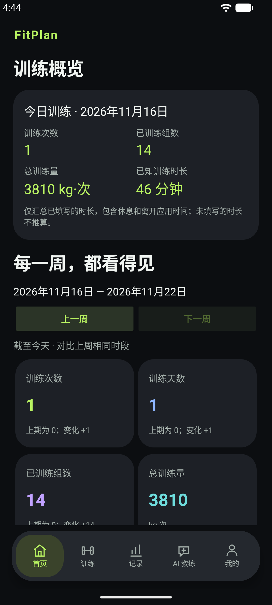
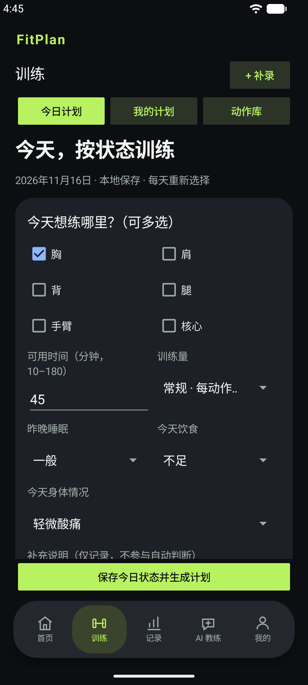

# FitPlan v0.6.3 使用说明

## 入口与流程

| 页面 | 内容 |
|---|---|
| 首页 | 今日训练四项指标＋完整周报、七天分布、部位分布、近八周趋势和单动作走势 |
| 训练 | 今日计划／我的计划／动作库；顶部 + 补录，存在进行中训练时显示继续训练 |
| 记录 | 历史查看、修正、删除与表现分析 |
| AI 教练、我的 | 保留已有功能和语言设置 |

打开「训练 → 今日计划」，填写身体状态和训练需求并生成计划。生成成功直接打开计划详情，确认重量或修改组次后点击「开始此计划」。同一天重新生成覆盖该日自动模板，不修改进行中训练快照。

「训练 → + 补录」可保存实际训练结果。返回时保留当前草稿；保存成功进入历史详情。补录和今日表单草稿沿用现有页面/Activity 状态保留机制，不承诺应用被强行结束后的草稿恢复。

首页默认展示本周，切换历史周只影响周报。顶部今日摘要根据设备本地时区计算，只统计历史内有效已训练组，进行中训练尚不计入。时长只汇总已知值，包含休息和离开应用时间；未填写不推算。保存、修正或删除历史后，回到首页刷新统计。

从首页进入表现分析后返回首页；从记录进入则返回记录。切换中英、页面和重建 Activity 后保留表单、所选周、趋势指标和进行中计时。旧 weekly 页面状态重定向到首页。

## 截图

首页使用日常模拟器中已有的带标记演示记录，不代表用户实际成果。截图日期以当时模拟器时钟为准；升级没有调整设备时钟或记录时间。

| 首页 | 训练 |
|---|---|
|  |  |

## 技术与交付

基于 codex/manual-workout-history-v0.6.2 的 968c352，在本地 feature/module-layout-v0.6.3 分支实现。DailyPlanScreen 承接原表单和生成规则，HomeScreen 与 WeeklyScreen 展示同一次后台计算的今日与周报快照；ReportEngine.Report 增加 today 摘要。没有数据库迁移或历史数据重写。

版本 0.6.3，versionCode 13。下载包使用当前 Windows 调试签名，不能覆盖其他签名包；不要通过卸载已有应用来尝试保留数据。API Key 未配置。详细检查结果见 [验证记录](TESTING.md)。本次变更尚未推送 GitHub。
